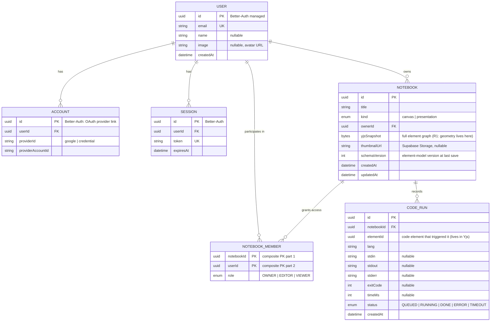

# Data Model — ER Diagram + Prisma 7 (Supabase Postgres)

> **Prisma 7 (stable).** ER diagram first, models derived from it — so nothing
> breaks. One schema file = single migration source of truth.
> **Core concept:** a user creates a **Notebook** (the project, Canva-style).
> The app *works inside a notebook*. Notebooks export/import as a single
> portable file (see [notebook-format.md](notebook-format.md)).

## 1. ER Diagram



**Why no more tables:** element geometry/payloads live **only in the Yjs doc**
(`Notebook.yjsSnapshot` + the Liveblocks room) — invariant R1. Images live in
Supabase Storage, referenced from element payloads by content hash. Anything
more (comments, templates, folders) is post-MVP.

## 2. Prisma 7 schema

```prisma
// Prisma 7 (stable): ESM-first `prisma-client` generator (output path required),
// Rust-free client — driver adapters are the standard runtime setup.
generator client {
  provider = "prisma-client"
  output   = "../src/generated/prisma"
}

datasource db {
  provider  = "postgresql"
  url       = env("DATABASE_URL")   // Supabase pooled (pgBouncer, :6543) — runtime
  directUrl = env("DIRECT_URL")     // Supabase direct (:5432) — migrations only
}

// ── Auth (Better-Auth Prisma adapter owns these — do not hand-edit fields) ──
model User {
  id        String       @id
  email     String       @unique
  name      String?
  image     String?
  createdAt DateTime     @default(now())
  accounts  Account[]
  sessions  Session[]
  notebooks Notebook[]   @relation("NotebookOwner")
  members   NotebookMember[]
}

model Account {
  id                String   @id
  userId            String
  user              User     @relation(fields: [userId], references: [id], onDelete: Cascade)
  providerId        String
  providerAccountId String
  // …remaining Better-Auth adapter columns are managed by better-auth
  @@unique([providerId, providerAccountId])
  @@index([userId])
}

model Session {
  id        String   @id
  userId    String
  user      User     @relation(fields: [userId], references: [id], onDelete: Cascade)
  token     String   @unique
  expiresAt DateTime
  // …remaining Better-Auth adapter columns are managed by better-auth
  @@index([userId])
}

// ── Domain ──────────────────────────────────────────────────────────────────

/// The project container. All app work happens inside a notebook.
/// Elements (text, ink, shapes, code, math, visualizers, images, frames)
/// live ONLY in the Yjs doc — snapshotted into `yjsSnapshot` per R1.
model Notebook {
  id            String       @id @default(uuid()) @db.Uuid
  title         String
  kind          NotebookKind @default(canvas)
  ownerId       String       @db.Uuid
  owner         User         @relation("NotebookOwner", fields: [ownerId], references: [id])
  yjsSnapshot   Bytes?
  thumbnailUrl  String?
  schemaVersion Int          @default(1)
  createdAt     DateTime     @default(now())
  updatedAt     DateTime     @updatedAt
  members       NotebookMember[]
  /// Owner-controlled: whether VIEWERs may run code (ADR-0003). Default off.
  allowViewerRuns Boolean    @default(false)

  @@index([ownerId, updatedAt])
}

enum NotebookKind {
  canvas
  presentation
}

model NotebookMember {
  notebookId String      @db.Uuid
  userId     String      @db.Uuid
  role       MemberRole
  notebook   Notebook    @relation(fields: [notebookId], references: [id], onDelete: Cascade)
  user       User        @relation(fields: [userId], references: [id])

  @@id([notebookId, userId])
  @@index([userId])
}

enum MemberRole {
  OWNER
  EDITOR
  VIEWER
  // COMMENTER — deferred (product-scope.md)
}

// CodeRun removed (ADR-0003): runs are per-user and ephemeral — results go only
// to the requesting client and are never persisted. Concurrency is guarded by an
// in-memory per-user run lock + rate limit in apps/api, not by DB rows.
```

## 3. Integrity rules (the "nothing breaks" checklist)

| Rule | Enforcement |
|---|---|
| Every notebook has exactly one OWNER | `Notebook.ownerId` + an `OWNER` row in `NotebookMember` created in the same transaction |
| Roles map to room scopes | `OWNER`/`EDITOR` → read-write Liveblocks token; `VIEWER` → read-only token. One `can(user, role, action)` helper in `apps/api` |
| SQL never stores geometry | Only `yjsSnapshot` (opaque binary) + membership |
| Deleting a notebook cleans up | `onDelete: Cascade` on members; Liveblocks room deletion via API hook; Storage objects reaped by the worker |
| One run per user at a time | In-memory per-user run lock in `apps/api` (notebook-wide); plus per-user rate limit (5/min) — nothing persisted (ADR-0002/0003) |
| Snapshot/room consistency | Room id = `notebook:{Notebook.id}`; snapshot written on unload + timer; open = load snapshot → `Y.applyUpdate` → room syncs |

## 4. Prisma 7 runtime notes

- Client import after generation: `import { PrismaClient } from "<pkg>/src/generated/prisma"` (ESM).
- Serverless setup: `new PrismaClient({ adapter: new PrismaPg({ connectionString: process.env.DATABASE_URL }) })` with `@prisma/adapter-pg` — pooled URL, `connection_limit=1`.
- Migrations: `prisma migrate dev` locally (uses `directUrl`), `prisma migrate deploy` in CI. Forward-only.

## 5. Supabase setup checklist

- [ ] Project created; copy pooled URL (6543) + direct URL (5432)
- [ ] Storage bucket `assets` (authed write, public read via signed URLs) — image elements + notebook thumbnails
- [ ] Row Level Security: **off** for tables — the API is the only DB client and enforces authz (simplest correct MVP posture)
